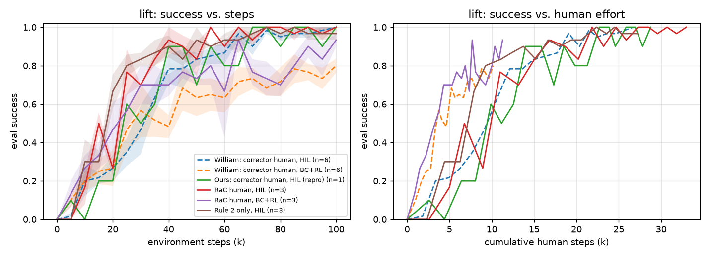
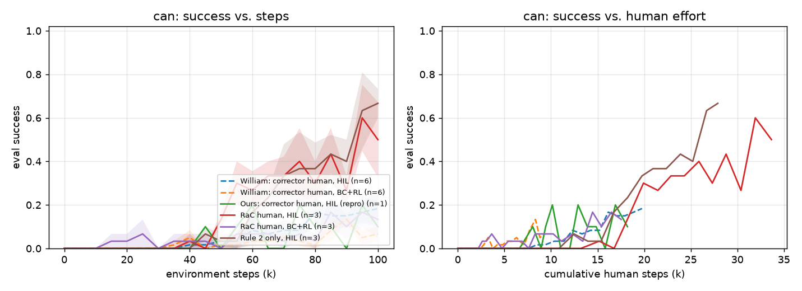

# RaC-style human: results

Code: `rlpd/human.py` (`--style=rac`, `--end_after_takeover`); see `Baselines/RaC notes.md`.
Scripts: `scripts/klone/` (Hyak, `ckpt-all`).

## Pilot: Lift, 2026-11-20 (`pilot_lift_20261120.csv`)

Script: `scripts/klone/rac_lift.sbatch`.
- **Stand-in human.** We trained our own, because William's checkpoints weren't
  accessible yet. It is plain RLPD on 20 demos, and `pick_ckpt.py` chose the
  25k-step checkpoint, which scored 55% on one 20-episode eval.
- **When the human steps in.** A random gate: a 0.5% chance per step, no full
  takeovers, takeovers last 10–40 steps.
- **Run settings.** 30k steps, UTD 10, temperature 0.01 (fixed), an
  evaluation every 2.5k steps with 20 episodes each, seeds 42 and 43.

Success is averaged over the last 3 evaluations (25k, 27.5k, 30k):

| Human | Learner | s42 | s43 | Human steps by 30k (s42 / s43) |
|---|---|---|---|---|
| Corrector only (Q-OIL style) | HIL | 0.28 | 0.57 | 3591 / 3294 |
| Corrector only | BC+RL (λ=0.1) | 0.10 | 0.08 | 3580 / 3241 |
| RaC (recover → correct, Rule 2) | HIL | 0.73 | 0.60 | 5011 / 4720 |
| RaC | BC+RL (λ=0.1) | 0.57 | 0.30 | 4314 / 4346 |

Take this as a smoke test only:
- **The comparison isn't effort-matched.** Rule 2 ends episodes early, so the
  RaC human runs more episodes and takes over about 1.3–1.4x as many steps.
- **The stand-in human is noisy.** Its neighboring checkpoints scored 25% and
  10%.
- **It's small.** Two seeds, 20-episode evals (SE about 0.11), and Lift is
  close to a single subtask.

As in William's runs, BC+RL does worse than HIL on Lift.

## Cap100 replication: Lift + Can (finished 2026-11-24)

### Takeaways

1. **Our branch reproduces William's setup.** `repro_hil` matches his 6-seed
   HIL on both tasks: avg success 0.67 vs 0.67 on Lift, 0.05 vs 0.06 on Can.
2. **Per environment step, the RaC human helps a lot.** HIL avg success rises
   from 0.67 to 0.75 on Lift and from 0.06 to 0.19 on Can. On Can, final
   success rises from 0.17 to 0.46.
3. **Rule 2 (end the episode after a takeover) alone gives the whole gain.**
   On both tasks it matches or beats the full RaC human, with fewer human
   steps. The scripted recovery adds nothing.
4. **Per human step, the Can gain disappears.** Ending episodes early means
   more episodes, so more takeovers per environment step: Rule 2 uses about
   1.4x William's human effort, and RaC about 1.7x. At the same human budget
   (≤18k human steps), the success of the last 3 evaluations is:
   - William's human: 0.16 ± 0.04
   - Rule 2 only: 0.13 ± 0.03
   - RaC human: 0.06 ± 0.04

   At ≤20k human steps they score 0.16, 0.19 and 0.11 respectively, which is
   within noise. On Lift, Rule 2 is still somewhat better at a matched budget
   (≤10k: 0.58 vs 0.40; ≤20k: 0.93 vs 0.85), but the RaC human is not.
   Compare HIL with HIL only here. BC+RL runs trigger far fewer takeovers, so
   at a small human budget they have trained for many more environment steps.
   `scripts/rac_results.py` prints these matched-budget numbers.
5. **BC+RL stays worse than HIL** under both humans, as in William's results.

For PHASE, this run gives no evidence that cloning or targeting the recovery
segment is what helps. What helped was the extra human-guided resets. It is
also a warning: a synthetic human that intervenes more will look better unless
results are plotted against human effort. We should report human-effort
curves (right panels below) for every method.

Caveat: William's runs stop at ~20k human steps because they end at 100k
environment steps, so the effort comparison only covers up to that point.
`scripts/klone/long_hil_cap100.sbatch` reruns William's human on Can to 150k
steps (3 seeds) to see whether it keeps pace with Rule 2 past 20k human steps.

Tables: generated by `python scripts/rac_results.py --ours runs_cap100
--william will_runs` on klone. `will_runs` holds the TensorBoard files of
William's `f10_cap100_{hil,bcrl}` and `can_cap100_{hil,bcrl}` runs from HF.
Avg success is averaged over every evaluation (Q-OIL's metric); ± is the
standard error over seeds. Each evaluation uses 10 episodes.

### Lift (100k steps)

| Run | Seeds | Avg success | Final (last 3 evals) | Human steps |
|---|---|---|---|---|
| William: corrector human, HIL | 6 | 0.67 ± 0.02 | 0.98 ± 0.01 | 26722 ± 832 |
| William: corrector human, BC+RL | 6 | 0.54 ± 0.05 | 0.77 ± 0.04 | 10163 ± 628 |
| Ours: corrector human, HIL (repro) | 1 | 0.67 | 0.97 | 28767 |
| RaC human, HIL | 3 | 0.75 ± 0.01 | 0.99 ± 0.01 | 32974 ± 699 |
| RaC human, BC+RL | 3 | 0.64 ± 0.03 | 0.89 ± 0.04 | 11272 ± 1085 |
| Rule 2 only, HIL | 3 | 0.76 ± 0.01 | 0.97 ± 0.02 | 27191 ± 2229 |

### Can (100k steps)

| Run | Seeds | Avg success | Final (last 3 evals) | Human steps |
|---|---|---|---|---|
| William: corrector human, HIL | 6 | 0.06 ± 0.01 | 0.17 ± 0.04 | 19770 ± 617 |
| William: corrector human, BC+RL | 6 | 0.03 ± 0.01 | 0.08 ± 0.02 | 9351 ± 447 |
| Ours: corrector human, HIL (repro) | 1 | 0.05 | 0.10 | 18207 |
| RaC human, HIL | 3 | 0.19 ± 0.01 | 0.46 ± 0.10 | 33661 ± 2006 |
| RaC human, BC+RL | 3 | 0.05 ± 0.03 | 0.13 ± 0.06 | 17532 ± 1310 |
| Rule 2 only, HIL | 3 | 0.18 ± 0.02 | 0.57 ± 0.03 | 27906 ± 226 |

### Setup

Script: `scripts/klone/rac_cap100.sbatch <lift|can>`. It matches William's
`f10_cap100_*` / `can_cap100_*` configs (HF `gilliamwong/qoil-runs`):
- **Stand-in human:** his corrector (Lift at 50k, Can at 75k).
- **Gate:** his progress gate, using the converged checkpoint as V (Lift 150k,
  Can 500k), with k=12, δ=-1.58 and α=0.599.
- **Takeovers:** 10–100 steps.
- **Run settings:** 100k steps, with an evaluation every 5k steps (10 episodes
  each).

The Q-OIL-style HIL and BC+RL baselines are William's existing 6-seed runs.
New runs:

| Run | Seeds | What it isolates |
|---|---|---|
| `repro_hil` | 42 | Sanity check that our branch reproduces William's HIL |
| `rac_hil` | 42–44 | Full RaC protocol, HIL learner |
| `rac_bcrl` | 42–44 | Full RaC protocol, BC+RL learner |
| `rule2_hil` | 42–44 | Rule 2 alone (no scripted recovery), so we can tell whether recovery or early termination drives any gain |
